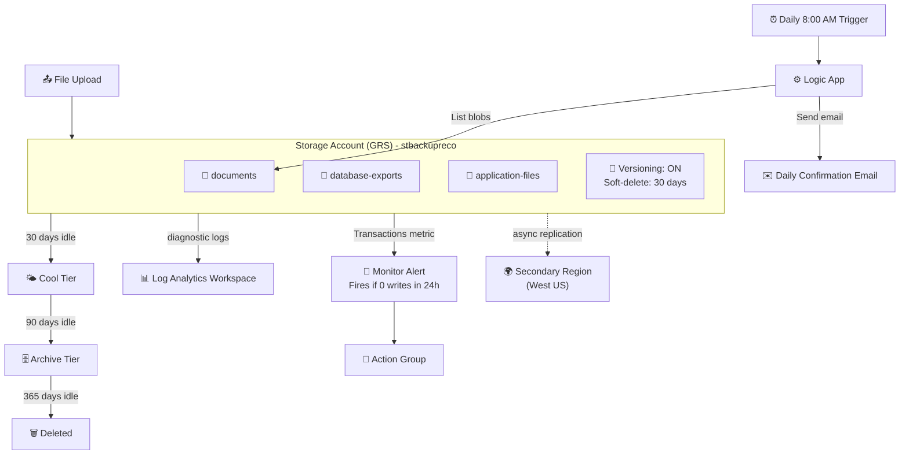

# ☁️ Project 2: Automated Backup System on Azure


A hands-on project where I built a **fully automated, self-verifying backup system** on Azure: geo-redundant storage, versioning, cost-aware lifecycle tiering, and a daily confirmation email, all provisioned as code.

---

## 📌 Overview

The most common backup strategy at small organizations is a person occasionally copying files to an external drive, which fails the moment that person is busy, out sick, or simply forgets. This project replaces that with infrastructure that backs itself up, tiers itself down to control cost, and tells someone every morning that it's still working, without anyone having to check.

| Detail | Value |
|---|---|
| **Difficulty** | Beginner |
| **Time to complete** | 3–4 hours |
| **Cloud Provider** | Microsoft Azure |
| **Core Services** | Blob Storage (GRS, versioning), Lifecycle Management, Log Analytics, Logic Apps, Monitor Alerts |
| **Core Concept** | Self-healing, self-reporting infrastructure |
| **Terraform Provider** | `hashicorp/azurerm ~> 5.0` |

> ⚠️ **Provider version note:** This project targets `azurerm` provider **v5.0**. Two schema changes from that major version bump show up directly in this code: `azurerm_storage_container` no longer accepts `storage_account_name` (use `storage_account_id` instead), and `azurerm_monitor_diagnostic_setting`'s `metric` block was renamed to `enabled_metric`. If you're following an older tutorial, see [Troubleshooting](#-troubleshooting) below.

---

## 🏗️ Architecture



**How it works:** Every file lands in one of three private containers and is immediately geo-replicated to a secondary region. Versioning silently keeps every prior copy of every file. A lifecycle policy quietly moves aging data to cheaper tiers with zero manual intervention. Independently, a Logic App checks in every morning and emails a status report, while a Monitor alert watches for the one scenario nobody wants to discover the hard way: backups silently stopping.

---

## ✅ Prerequisites

- **Mac:** Homebrew → Terraform + Azure CLI (`brew install hashicorp/tap/terraform azure-cli`)
- **Windows:** Terraform + Azure CLI installers, added to `PATH`
- `az login` and an active subscription selected
- *(If Project 1 or the data lab was already completed, tooling is already installed.)*

---

## 🏷️ Key Variables

| Variable | Example | Purpose |
|---|---|---|
| `yourname` | `reco` | Keeps resource names globally unique |
| `location` | `East US` | Primary region (GRS replicates to a paired secondary automatically) |
| `alert_email` | *(your email)* | Destination for the daily confirmation + failure alerts |

---

## 🚀 What Gets Built

```
rg-backup-reco
├── Storage Account (GRS, versioning, TLS 1.2 minimum)
│   ├── documents/            (private)
│   ├── database-exports/     (private)
│   └── application-files/    (private)
├── Lifecycle Policy - Hot → Cool (30d) → Archive (90d) → Delete (365d)
├── Log Analytics Workspace
├── Storage Diagnostic Settings → Log Analytics
├── Monitor Action Group + Alert (fires on 0 writes / 24h)
└── Logic App (daily 8 AM confirmation email)
```

### Key Design Decisions

| Setting | Value | Why |
|---|---|---|
| `account_replication_type` | `GRS` | Geo-redundant, survives a full regional outage, unlike LRS |
| `min_tls_version` | `TLS1_2` | Blocks legacy, vulnerable TLS versions from connecting |
| `versioning_enabled` | `true` | Every overwrite/delete keeps the prior version, real point-in-time recovery |
| `delete_retention_policy.days` | `30` | Soft-delete safety net even after versioning |
| `container_access_type` | `private` | Backup data is never publicly reachable |
| Lifecycle tiering | 30d → Cool, 90d → Archive, 365d → Delete | Controls storage cost automatically as data ages |
| `storage_account_id` (not `storage_account_name`) | `azurerm_storage_account.backup.id` | Required by provider v5.0: `storage_account_name` was fully removed from `azurerm_storage_container` and `azurerm_storage_management_policy` |

---

## 🛠️ Deployment Steps

### 1. Folder Setup
```bash
mkdir ~/backup-system-001 && cd ~/backup-system-001
touch main.tf variables.tf outputs.tf terraform.tfvars
```

### 2. Configure Variables
`terraform.tfvars`:
```hcl
yourname    = "reco"
location    = "East US"
alert_email = "your.email@example.com"
```

### 3. Deploy
```bash
terraform init
terraform plan
terraform apply
```
Expect **11 resources** to be created, in roughly 2–3 minutes.

### 4. Configure the Daily Confirmation Logic App (Portal)
```
la-backup-confirm-reco → Logic app designer
  Trigger: Recurrence - Day, every 1, at 8:00 AM
  + New step: Azure Blob Storage → List blobs
    (connect using: terraform output -raw storage_account_connection_string)
    Container: documents
  + New step: Office 365 Outlook → Send an email (V2)
    Subject: Daily Backup Confirmation - @{formatDateTime(utcNow(), 'yyyy-MM-dd')}
    Body: Backup system status: Active. Files in documents container: @{length(body('List_blobs')?['value'])}.
```

### 5. Test Versioning End-to-End
```bash
# Upload v1
echo "Backup test file created $(date)" > /tmp/backup_test.txt
az storage blob upload --account-name stbackupreco --container-name documents \
  --name test/backup_test.txt --file /tmp/backup_test.txt --auth-mode login

# Overwrite to create v2
echo "Updated content - second version $(date)" > /tmp/backup_test.txt
az storage blob upload --account-name stbackupreco --container-name documents \
  --name test/backup_test.txt --file /tmp/backup_test.txt --auth-mode login --overwrite

# Confirm both versions exist
az storage blob list --account-name stbackupreco --container-name documents \
  --include v --auth-mode login --output table
```
✅ Two rows should appear for the same blob: current version and one prior version.

---

## ✅ Verification Checklist

- [ ] Storage account `stbackupreco` exists
- [ ] Versioning shows **Enabled**
- [ ] Lifecycle rule `backup-lifecycle` is present
- [ ] All three containers exist and are private
- [ ] Logic App runs on its recurrence trigger
- [ ] Alert rule `alert-no-backup-writes` exists in Monitor
- [ ] Test upload produced two versions

---

## 🐛 Troubleshooting

| Issue | Cause | Fix |
|---|---|---|
| `BlobAccessTierNotSupported` | Archive tier unavailable for GRS in some regions | Lengthen the archive threshold or remove that rule |
| Logic App blob connection fails | Connection string entered incorrectly | Re-run `terraform output -raw storage_account_connection_string` and paste the full value |
| Alert fires immediately | No write activity has happened yet | Run the test upload steps; the alert evaluates a rolling 24-hour window |
| Versions not visible in portal | Portal hides versions by default | Toggle **Show versions** in the container view |
| `The argument "storage_account_id" is required, but no definition was found` | Using provider v5.0 with old `storage_account_name` syntax (deprecated in v4.0, removed entirely in v5.0) | Replace `storage_account_name = azurerm_storage_account.backup.name` with `storage_account_id = azurerm_storage_account.backup.id` on every `azurerm_storage_container` and on `azurerm_storage_management_policy` |
| `azurerm_storage_account.backup_id` reference errors | Typo: Terraform references use dot notation (`<type>.<name>.<attribute>`), not an underscore | Use `azurerm_storage_account.backup.id`, never `azurerm_storage_account.backup_id` |
| `Blocks of type "metric" are not expected here` | Provider v5.0 renamed the `metric` block to `enabled_metric` (same treatment `log` got as `enabled_log` in an earlier version) | Replace `metric { category = "Transaction" enabled = true }` with `enabled_metric { category = "Transaction" }`; no `enabled` flag needed, the block's presence means it's on |

---

## 🧹 Teardown
```bash
terraform destroy
```

---

## 🔐 Security Notes

- **Geo-redundancy is a resilience control, not just a cost line item.** GRS means a full regional Azure outage doesn't equal data loss, a meaningful distinction from the LRS pattern used in earlier labs, where redundancy stayed inside one datacenter.
- **Versioning + soft-delete is layered defense against the most common data-loss cause: human error**, not just hardware failure. Most real "we lost our data" incidents are someone deleting or overwriting the wrong file, not a disk failing.
- **`container_access_type = "private"` matters precisely because it's easy to get wrong.** Publicly-readable storage containers holding backup data are a recurring real-world breach pattern; this project defaults to private for all three containers from the start.
- **`sensitive = true` on the connection string** keeps Terraform from echoing it to the console, but the connection string itself is a long-lived, full-access credential. In a production system, this would be replaced with **Managed Identity** and RBAC role assignments (as built in the earlier PaaS/Key Vault lab) rather than a connection string passed around manually.
- **Monitoring the absence of activity is as important as monitoring failures.** The "zero writes in 24 hours" alert catches silent failures: a backup job that stopped running weeks ago produces no errors, only silence, which is exactly why it goes undetected without this kind of alert.

---

## 📚 What I Learned

- Configuring geo-redundant storage (GRS) and understanding when it's the right redundancy choice
- Implementing blob versioning and soft-delete as complementary data-protection layers
- Writing cost-aware lifecycle management policies that move data through storage tiers automatically
- Routing storage diagnostics into Log Analytics for auditability
- Building a Logic App workflow triggered on a recurrence schedule
- Designing a "detect silence, not just failure" monitoring alert
- Where connection-string-based access falls short of Managed Identity in a real production design
- Diagnosing a Terraform provider major-version breaking change (`storage_account_name` → `storage_account_id` in azurerm v5.0) by reading the error message, checking the installed provider version, and cross-referencing HashiCorp's official upgrade guide
- Terraform's resource reference syntax (`<resource_type>.<local_name>.<attribute>`) and a real example of what breaks when it's written incorrectly
- Recognizing a pattern across provider breaking changes: `log` → `enabled_log`, then `metric` → `enabled_metric`: the same "presence means enabled" redesign applied twice in the same resource

---

**Author:** Reco
